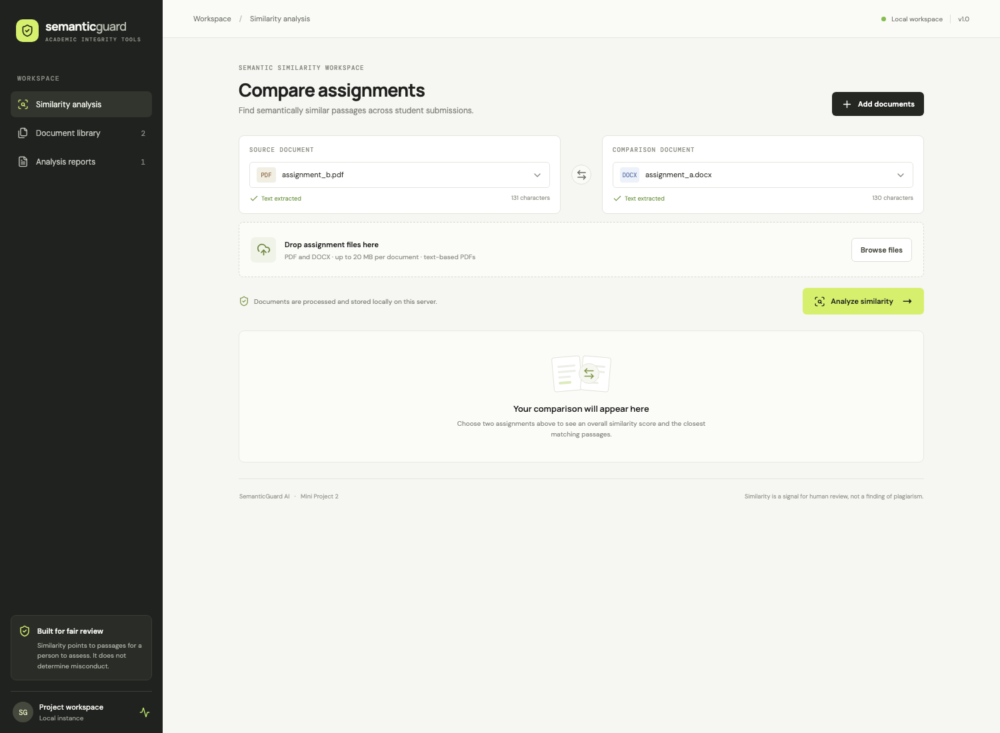
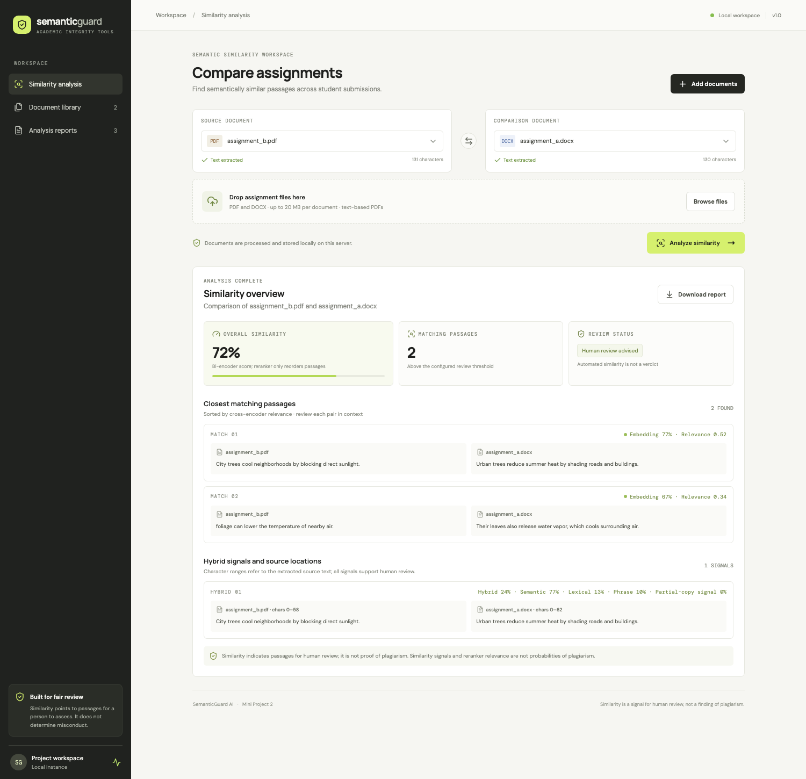
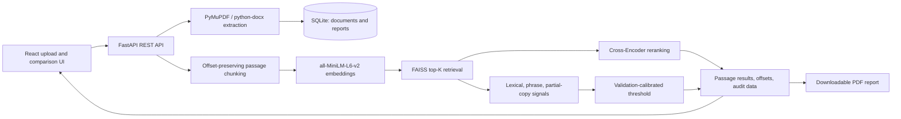

# SemanticGuard AI

SemanticGuard AI is a local-first college mini project for comparing PDF and DOCX assignments and surfacing passages for human review. It combines sentence embeddings, FAISS retrieval, Cross-Encoder reranking, and a separately calibrated lexical/phrase hybrid signal. Similarity results are not proof of plagiarism and must not be treated as probabilities or misconduct decisions.

## Screenshots





Screenshots show the local MVP interface and synthetic sample assignments. No real student submissions are included.

## Architecture



All document processing and inference run locally. First use requires network access to download model weights unless they are already cached. FAISS runs in an isolated worker on macOS to avoid conflicting OpenMP runtimes. Original extracted text is stored as-is; normalized passage display text keeps half-open character offsets into that extraction. These offsets identify extracted-text ranges, not PDF coordinates or DOCX layout positions.

## Features

- PDF and DOCX upload, extraction, local storage, and document history.
- Sentence Transformer embeddings, FAISS candidate retrieval, and optional Cross-Encoder reranking.
- Separate semantic, lexical, contiguous phrase-overlap, and partial-copy signals.
- Reference heading and instructor-configured boilerplate filtering, with excluded source text and offsets retained for audit.
- Side-by-side passage review, extracted-text source ranges, saved analysis history, and PDF reports.
- Synthetic validation/test evaluation with split-leakage checks and validation-only weight/threshold selection.

## Requirements

- Python 3.10–3.12 (Python 3.12 is the tested local version)
- Node.js and npm
- Internet on the first model load, unless both Hugging Face models are already cached

## Clean installation and run

Open two terminals in the project root.

### Backend

```bash
cd backend
python3.12 -m venv .venv
source .venv/bin/activate       # Windows PowerShell: .venv\Scripts\Activate.ps1
python -m pip install --upgrade pip
pip install -r requirements-dev.txt
python -m pytest -q
uvicorn app.main:app --reload
```

The API listens at `http://localhost:8000`; interactive OpenAPI docs are at `http://localhost:8000/docs`. Model downloads happen lazily during the first comparison. For offline operation, cache both models first and set `HF_HUB_OFFLINE=1`.

### Frontend

```bash
cd frontend
npm ci
npm run dev
```

Open `http://localhost:5173`. The frontend calls `http://localhost:8000` by default. Set `VITE_API_URL` at build/dev time to use another API origin. To create a production bundle, run `npm run build`.

## API

Requests and responses use JSON except document upload (`multipart/form-data`) and PDF download. Common errors use FastAPI JSON detail responses.

| Method and path | Purpose | Success |
|---|---|---|
| `GET /api/health` | Check service status | `200` |
| `POST /api/documents` | Upload a `.pdf` or `.docx` in multipart field `file` | `200`, document ID/metadata |
| `GET /api/documents` | List uploaded documents | `200`, array |
| `DELETE /api/documents/{id}` | Remove document and related reports | `204` |
| `POST /api/analysis/compare` | Compare `document_a_id` and `document_b_id` | `200`, scores and passage results |
| `GET /api/reports` | List saved comparisons | `200`, array |
| `GET /api/reports/{id}` | Fetch report, hybrid details, excluded-passage audit | `200` |
| `GET /api/reports/{id}/download` | Download report PDF | `200`, `application/pdf` |

Example comparison request:

```json
{"document_a_id": 1, "document_b_id": 2}
```

The response preserves legacy `similarity` and `matches` fields. It adds `hybrid_matches` with separate signal fields and `source_a`/`source_b` `{start_char,end_char}` ranges; `excluded_passages` contains source text, offsets, and filter reasons. `rerank_score` is a ranking signal. None of these values is a plagiarism probability.

Typical upload errors: `400` empty file, `413` over the configured size limit, `415` unsupported extension, `422` unreadable/empty extracted text. Comparison returns `400` for the same document twice, `404` for missing IDs, and `422` when there is insufficient comparable text.

## Configuration and data handling

Defaults are in `backend/app/config.py`; `backend/.env.example` lists local settings. Environment variables include `DATABASE_URL`, `UPLOAD_DIR`, `MODEL_NAME`, `MAX_UPLOAD_MB`, `MIN_SIMILARITY`, `TOP_K`, `CORS_ORIGINS`, and `BOILERPLATE_PHRASES` (JSON list). Local uploads and SQLite data are ignored by Git. Do not commit credentials, student work, or the local database.

The hybrid calibration in `evaluation/results/hybrid_calibration.json` was selected on the bundled synthetic validation set. It is not calibrated for real student writing. Configure boilerplate phrases explicitly for a course; the filter does not infer that a prompt is boilerplate.

## Evaluation and verification

Run all backend and evaluation tests from `backend/`:

```bash
python -m pytest tests ../evaluation/test_evaluation.py ../evaluation/test_phase4.py -q
```

Build the frontend from `frontend/` with `npm run build`.

The Phase 3 full-candidate benchmark is `evaluation/benchmark.py`. The Phase 4 validation-calibration and held-out pair benchmark is `evaluation/phase4_benchmark.py`. Reports and CSV/JSON outputs are in `evaluation/results/`. The bundled datasets are synthetic, small, and controlled. Phase 4 held-out results did **not** demonstrate a hybrid improvement over the baseline, and the set is not suitable for claiming real-world plagiarism accuracy. Details and limitations are in [evaluation/README.md](evaluation/README.md).

## Limitations

- Scanned/image-only PDFs are not supported; OCR is not implemented.
- Models are general-purpose embedding/search models, not trained or calibrated to decide plagiarism.
- Character offsets refer to extracted text and do not map to exact PDF page geometry or Word layout.
- The Cross-Encoder is pretrained for MS MARCO search relevance; its score can misrank assignment passages.
- Synthetic evaluation is not representative of real coursework, domains, languages, or writing styles.
- No LLM explanation, multilingual matching, batch cohort scan, authentication, or production deployment is included.

The system is a human-review aid. Similarity alone cannot establish copying, intent, or misconduct.
